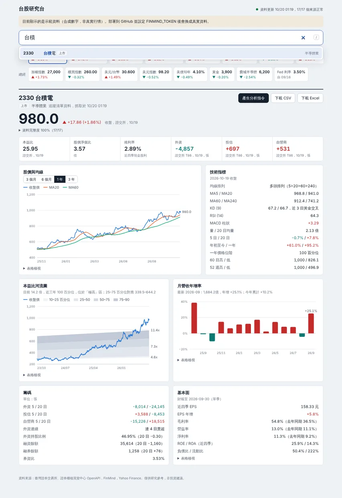

# 台股研究台 (tw-stock-dashboard) v6

個人台股研究儀表板：追蹤清單總覽、全市場搜尋、技術指標、本益比河流圖、月營收、籌碼與財報，
一鍵產生可貼到任何 AI 的分析指令，可匯出 CSV / Excel。

**網站**：https://tingchen0329.github.io/tw-stock-dashboard/



## 架構

```mermaid
flowchart LR
  S[(GitHub Secrets<br/>FINMIND_TOKEN)] -. 環境變數 .-> A
  subgraph GitHub Actions（排程 / push）
    A[scripts/fetch_data.py] --> J[_site/data/*.json<br/>不含 token]
  end
  T[證交所 / 櫃買 OpenAPI] --> A
  F[FinMind API] --> A
  Y[Yahoo Finance] --> A
  J --> P[GitHub Pages]
  P --> B[瀏覽器]
  B -. 清單外股票<br/>免 token 即時查詢 .-> F
```

- **token 永遠不進瀏覽器**：只存在 GitHub Secrets，由 Actions 在伺服器端使用（[原因與設定](docs/SETUP.md)）
- **全市場資料**（證交所 + 櫃買）伺服器端抓好，不再依賴不穩定的公共 CORS proxy
- **追蹤清單**（`config/watchlist.csv`，可直接用 Yahoo 自選股整理的 CSV）用 FinMind token 預抓 3 年完整資料；
  收盤後完整更新，盤中與夜間只更新行情與總經（[更新時段](docs/SETUP.md)）
- **清單外股票**仍可搜尋，網頁用 FinMind 免 token 額度即時查詢

## 開始使用

1. **Settings → Secrets and variables → Actions** 新增 `FINMIND_TOKEN`
2. **Settings → Pages → Source** 選 **GitHub Actions**
3. **Actions → Update data & deploy → Run workflow**

詳細步驟與疑難排解：[docs/SETUP.md](docs/SETUP.md)

## 功能

| 區塊 | 內容 | 資料來源 |
|---|---|---|
| 總覽（首頁） | 追蹤清單每檔一列：股價、60 日走勢、本益比、河流圖位階、營收 / EPS 年增、ROE、法人 20 日、均線、KD、RSI；可排序、篩選個股 / ETF | 同下 |
| 選股 | 全市場上市櫃個股：成長型（營收、獲利成長）、殖利率型（高殖利率、低本益比）兩組條件，門檻可自訂 | 證交所、櫃買開放資料（月營收、損益表、本益比） |
| 搜尋 | 代號、名稱、部分名稱、全形數字、臺/台、產業別；`/` 快速聚焦、↑↓ Enter | FinMind TaiwanStockInfo |
| 報價與估值 | 收盤 / 盤中價、本益比、股價淨值比、殖利率、三大法人 | 證交所、櫃買、Yahoo |
| 技術面 | MA5/20/60/240、均線排列、KD、RSI、MACD、量比、區間報酬、價格位階、前高前低 | FinMind（3 年日線） |
| 估值 | 本益比河流圖（近 3 年 10/25/50/75/90 百分位） | FinMind PER |
| 基本面 | 月營收年增 / 月增 / 累計、近四季 EPS、三率、ROE、ROA、負債比、流動比 | FinMind |
| 籌碼 | 法人 5 / 20 日、外資連續買賣、外資持股比例、融資券、券資比 | FinMind |
| 總經 | 加權、櫃買、台指期夜盤、道瓊、那斯達克、費半、美元/台幣、美元指數、美債 10 年、黃金、Fed 利率 | Yahoo、FinMind、期交所 |
| 開休市 | 休市、盤前、盤中提示與資料日期；颱風等臨時休市由資料自動判斷 | 證交所休市日 OpenAPI |
| 輸出 | 分析指令（精簡版，可貼到 Claude / ChatGPT / Gemini）、CSV、Excel（5 個工作表） | — |

## FinMind Skill 與 AI 分析

| 用法 | 環境 | 怎麼用 | 費用 |
|---|---|---|---|
| 網頁「產生分析指令」 | 任何 AI（claude.ai、ChatGPT、Gemini、Copilot） | 按鈕 → 自動複製 → 貼到對話 | 免費 |
| `/finmind` 官方 Agent Skill | Claude Code（在此 repo 內） | `export FINMIND_TOKEN=...` 後輸入 `/finmind 2330 三大法人近一週買賣` | 免費（用 FinMind 額度） |
| `tw-stock-report` skill | Claude Code（在此 repo 內） | 「幫我分析 2330」→ 自動跑 `scripts/summarize.mjs` 並寫七段報告 | 免費 |
| `scripts/summarize.mjs` | 終端機 | `node scripts/summarize.mjs 台積電 --prompt` | 免費 |
| FinMind MCP Server | Claude Desktop / Claude Code | `/plugin marketplace add FinMind/FinMind-MCP` → `/plugin install finmind-mcp@finmind-official` | 免費 |
| FinMind llms.txt | claude.ai 網頁版 | 對話中貼上 https://finmind.github.io/llms.txt（或 llms-full.txt），請 AI 先讀；只會產生程式碼與說明，不會實際抓資料 | 免費 |

`/finmind` 與網頁使用**同一套** `assets/js/analytics.js` 計算，終端機與網頁的 KD、河流圖數字會一致。
Skill 檔案取自 FinMind 官方 repo（Apache-2.0，見 `.claude/commands/finmind-references/NOTICE.md`）。

## 費用

預設配置 **每月 NT$0**。

| 項目 | 方案 | 費用 | 本專案用量 / 說明 |
|---|---|---|---|
| GitHub repo + Actions | Free（公開 repo） | NT$0 | 公開 repo 的標準 runner 不計分鐘數。每交易日 13 次，各約 0.5–3 分鐘。若改私有 repo，每月有 2,000 分鐘免費額度，本專案約用 500 分鐘 |
| GitHub Pages | Free | NT$0 | 網站約 2 MB；軟上限 1 GB 容量、每月 100 GB 流量 |
| 證交所 / 櫃買 OpenAPI | 政府開放資料 | NT$0 | 全市場行情、本益比、三大法人 |
| Yahoo Finance chart API | 非官方、免費 | NT$0 | 指數、匯率、盤中價。無服務保證，偶爾限流 |
| FinMind 註冊會員 | Free | NT$0 | 每小時 600 次；收盤後完整更新約 510 次（68 檔），其他時段約 3 次。清單上限約 70 檔 |
| Claude | 你現有的方案 | 不增加 | 貼上「分析指令」或在 Claude Code 使用 skill |
| *選用* FinMind Backer | 付費 | NT$699/月 | 單日全市場批次下載（可做全市場篩選）、股權分散表（千張大戶）、還原股價 |
| *選用* FinMind Sponsor | 付費 | NT$999/月 | 盤中即時快照、分點進出、八大行庫 |
| cron-job.org | Free | NT$0 | 外部排程，準時觸發更新（[設定](docs/SCHEDULER.md)） |
| *選用* 自訂網域 | 網域商 | 約 NT$400–1,000/年 | 例如 stock.你的網域.tw |

FinMind 價格取自 https://finmind.github.io/Pricing/ （2026-10）。分析框架中「千張大戶、借券、景氣燈號」
在免費方案沒有資料，網頁與分析指令都會明確標示 N/A。

## 本機開發

```bash
./scripts/preview.sh                 # 合成資料預覽（不需網路與 token）→ http://localhost:8000
./scripts/preview.sh --live          # 真實資料（需 export FINMIND_TOKEN）
python -m unittest discover -s tests/py
node --test "tests/js/*.test.mjs"
python tests/e2e/test_dashboard.py   # 需 pip install playwright && playwright install chromium
python tests/bench/run_bench.py      # 新舊版效能比較
```

## 版本控制

- 每個版本一個 tag：`v5.1.0`（舊版單檔）、`v6.0.0`（本版）。變更記錄見 [CHANGELOG.md](CHANGELOG.md)
- **回到舊版**：`git checkout v5.1.0 -- index.html` 或在 GitHub 的 Releases / Tags 下載
- **建議流程**：開分支 → push 後 CI 自動跑測試（`.github/workflows/ci.yml`）→ 開 PR → 合併到 main → 自動部署
- **改壞了**：`git revert <commit>` 後 push，網站會自動回復
- Dependabot 每月檢查 GitHub Actions 版本並開 PR

## 檔案結構

```
index.html                    網頁骨架（含 CSP）
assets/
  css/app.css                 樣式（淺色 / 深色，色票經色盲模擬驗證）
  datasets.json               FinMind 資料集規格（Python 與網頁共用）
  js/main.js                  進入點：狀態、事件、路由
  js/data.js                  載入靜態 JSON / FinMind 即時查詢
  js/net.js                   請求：快取、共用、逾時、取消
  js/search.js                全市場搜尋
  js/analytics.js             指標計算（純函式）
  js/charts.js                SVG 圖表
  js/render.js                畫面
  js/prompt.js                分析指令
  js/market.js                開休市狀態（純函式）
  js/overview.js              追蹤清單總覽表
  js/screen.js                全市場選股
  js/export.js                CSV / XLSX
  js/format.js                數字與日期格式
config/watchlist.csv          追蹤清單（Yahoo 自選股 CSV）
scripts/fetch_data.py         資料管線（GitHub Actions 執行）
scripts/build_overview.mjs    總覽表資料（Actions 執行，與網頁同一套計算）
scripts/summarize.mjs         終端機版個股摘要
scripts/preview.sh            本機預覽
tests/                        py / js / e2e / bench / fixtures（合成資料產生器）
.github/workflows/            deploy.yml（排程 + 部署）、ci.yml（PR 測試）
.claude/                      FinMind skill、tw-stock-report skill
docs/                         SETUP、PERFORMANCE、截圖
```

## 已知限制

- 盤中價來自 Yahoo，約延遲 20 分鐘；即時報價需要 FinMind Sponsor
- 櫃買三大法人的公開欄位沒有穩定文件，採關鍵字比對；每次執行的 Summary 會顯示是否成功
- 財報 EPS 以 FinMind 單季數值加總；「隱含 EPS」（河流圖）= 收盤 ÷ 本益比
- 公開 repo 60 天沒有 commit，GitHub 會停用排程（見 SETUP 疑難排解）

僅供個人研究參考，非投資建議。資料來源：臺灣證券交易所、證券櫃檯買賣中心、FinMind、Yahoo Finance。
